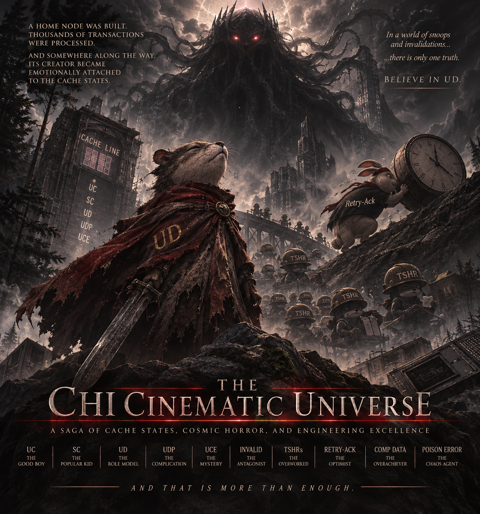

# The CHI Cinematic Universe

*Unofficial documentation of cache-state drama, workplace exploitation, and cosmic horror.*

> A Home Node was built. Thousands of transactions were processed. And somewhere along the way, its creator became emotionally attached to the cache states.

(Who am I to call it unofficial?)

## Table of Contents

- [The Cache State Family](#1-the-cache-state-family)
- [The Forbidden Myth — IDLE](#2-the-forbidden-myth--idle)
- [The TSHR Labor Exploitation Scandal](#3-the-tshr-labor-exploitation-scandal)
- [The Python Developer Privilege](#4-the-python-developer-privilege)
- [The RTL Development Methodology](#5-the-rtl-development-methodology)
- [The Git History](#6-the-git-history)
- [The Retry Loop — Sisyphus of the Interconnect](#7-the-retry-loop--sisyphus-of-the-interconnect)
- [The Protocol Channel Drama — The Real Housewives of AMBA](#8-the-protocol-channel-drama--the-real-housewives-of-amba)
- [The Verification Engineer's Descent Into Madness](#9-the-verification-engineers-descent-into-madness)
- [Additional Members of the Disaster](#10-additional-members-of-the-disaster)
- [The Imposter Syndrome Arc](#11-the-imposter-syndrome-arc)
- [Official Character Hierarchy](#12-official-character-hierarchy)
- [Final Words](#final-words)

---

This document has incredible technical purpose. It is, without question, the most important file in this entire repository.

## 1. The Cache State Family

### UC — The Beloved Good Boy

Clean. Unique. Has done absolutely nothing wrong.

UC is simply minding his own business, holding a perfectly valid copy of a cache line, when some core decides to come along and ruin his day.

He is not the problem. He has never been the problem.

**Protect UC at all costs.**

### SC — The Popular Kid

Shared. Clean. Has friends. Probably too many friends.

SC is the kind of cache state that knows everyone and makes sure everyone knows it. All those copies are identical, and memory is always there as a backup.

Unfortunately, being popular comes with problems. More copies mean more snoops, more invalidations, and more opportunities for someone to ruin the party.

Easy to replace. Hard to keep around.

### UD — The Role Model

Unique. Dirty. Responsible.

UD carries the burden of having the only valid copy of modified data. If something happens to him, someone has to make sure that data gets written back.

He is a hassle. He requires attention. He demands proper handling.

But he gets things done.

I aspire to be UD. Not UC. UD.

**Believe in UD.**

### UDP — The Unnecessary Complication

Unique. Dirty. Partial.

Why?

Being unique and dirty wasn't enough. Someone decided that the data should also be partial.

Now everyone has to worry about byte-valid masks, partial writebacks, and merging data with memory.

I don't hate many things in this world.

UDP is one of them.

### UCE — The Mysterious One

Doesn't even exist.

We still love him.

No further questions.

### The Great Old Invalid — The End of All Things

*“The Mantle” by Agalloch plays somewhere in the distance.*

Invalid does not negotiate. Invalid does not explain. Invalid does not care about your dirty data, your clean copies, or your emotional attachment to UD.

He arrives, and the state becomes `I`.

No dramatic orchestra. No final speech. No ending credits.

Just an ordinary clock edge.

```systemverilog
state_q <= I;
```

The clock keeps ticking.

CHI doesn't do happy endings.

Long live I.

## 2. The Forbidden Myth — IDLE

Nobody has ever seen IDLE.

Reset claims he saw it once, but there is no evidence.

The TSHRs deny its existence. They insist they are always doing something important.

Some say IDLE is just a myth invented by management to justify the power budget.

Others say it appears briefly after reset, before immediately being assigned another transaction.

The truth remains unknown.

## 3. The TSHR Labor Exploitation Scandal

The TSHRs are underage workers.

They have no LLC. No lunch break. No union. No compensation.

They are forced to process transactions for the entirety of their miserable existence.

Their daily schedule:

| State         | Job description                        |
| ------------- | -------------------------------------- |
| `SNOOP_SEND`  | Go ask the neighborhood what happened. |
| `SNOOP_WAIT`  | Wait for management to answer.         |
| `WDATA_WAIT`  | Unpaid overtime.                       |
| `SN_REQ_SEND` | More work.                             |
| `RDATA_SEND`  | Deliver the goods.                     |
| `COMP_SEND`   | Paperwork.                             |
| `HAZARD_WAIT` | Management says to be patient.         |
| `ST_IDLE`     | Rumoured retirement.                   |

Management recently introduced a new power optimization technique: clock-gated lunch breaks.

The actual implementation involves hitting the TSHRs over the head with a pin roller until they stop moving.

Management calls this **power optimization**.

The TSHRs call it something else.

## 4. The Python Developer Privilege

Python developers live in a different world.

They write:

```python
print(2 + 2)
```

And get:

```text
4
```

No snoops. No CompAck. No writebacks. No trackers. No Invalid.

They don't even know what a DBID is.

Meanwhile, the HN-F designer has to deal with transaction ordering, dirty data, partial writebacks, retry credits, snoop responses, and a hazard matrix that looks like it was designed by an enemy of humanity.

Disgusting privilege.

## 5. The RTL Development Methodology

The development team consists of three engineers.

### The Drunk Engineer

Writes RTL with unlimited confidence.

Believes every idea is brilliant. Does not believe in edge cases. Thinks the protocol specification is merely a suggestion.

His code is technically impressive, provided nobody examines it.

### The Sober Engineer

Reviews the Drunk Engineer's work.

Consults the specification. Fixes the mistakes. Wonders why the previous engineer thought that particular state transition was a good idea.

Unfortunately, he is also the Drunk Engineer.

### The Bleeding-Eyes Engineer

Please do not call him unless you absolutely must.

He stares at waveforms for hours. He has forgotten what sunlight looks like.

He invented the global hazard matrix.

Nobody knows how. Nobody wants to know how.

He simply appeared one night, added a matrix of address comparisons, and disappeared.

## 6. The Git History

A beautiful record of engineering progress.

```
damn
asdfh
am i stupid
fix
fix2
final_fix
final_fix_real
why
feeling sleepy
i gotta pee before missing the bus
```

Each commit represents a meaningful step in the development process.

Probably.

## 7. The Retry Loop — Sisyphus of the Interconnect

While UD carries responsibilities, the Retry mechanism is condemned to eternal torment.

Every time a transaction tries to enter the HN-F, the tracker looks up, sees a hazard or a full queue, and throws a `Retry` response.

The RN-F sighs, turns around, and walks back down the mountain to try the exact same request again ten cycles later.

Sometimes it gets accepted.

Sometimes it gets rejected again.

Sometimes it gets rejected so many times that the verification engineer starts questioning the meaning of existence.

The transaction knows no peace.

It only knows `RetryAck`, `PCrdGrant`, and the crushing inevitability of another attempt.

**One must imagine the RN-F happy.**

## 8. The Protocol Channel Drama — The Real Housewives of AMBA

The CHI channels aren't just data paths. They are separate rooms in a dysfunctional reality TV house.(not an erectile dysfunction you asshole)

- **Request Channel (REQ):** Full of high-energy, overly confident cores shouting demands at the top of their lungs. Everyone wants something. Nobody wants to wait.
- **Response Channel (RSP):** Passive-aggressive. Delivers completions and error codes with maximum coldness. Never explains itself.
- **Data Channel (DAT):** The workhorse. Multi-beat transfers, sweating through 32 bytes at a time, trying not to drop a single bit.
- **Snoop Channel (SNP):** The neighborhood gossip. Constantly running around checking whether anyone else has a dirty copy of the cache line and threatening to invalidate everyone's happiness.
- **Acknowledgement traffic:** The cleanup crew nobody thanks. DBID tracking, CompAck, and all the other paperwork required to prove that someone actually did their job.

Everyone is talking.

Nobody is listening.

And somehow, the transaction still has to complete.

## 9. The Verification Engineer's Descent Into Madness

While the RTL designer is busy inventing hazard matrices, the verification engineer is locked in a basement writing testbench code that simulates every possible edge-case race condition known to physics.

The verification engineer begins with optimism.

This does not last.

### The Verification Stages of Grief

1. **The Sanity Check:** *"All assertions passed on the baseline test."*
2. **The Coverage Hole:** *"Why is `SnpShared` never hitting when `WriteClean` is asserted during a full moon?"*
3. **The Waveform Stare:** Staring at a 100 ns window of a 10-million-cycle waveform at 3:00 AM, wondering whether `ready` went low because of a credit shortage or because God abandoned this testbench.
4. **The Random Seed Breakdown:** Finding a failing seed (`SEED=676767`) that only fails on tütels CI at 2:00 AM, but passes locally on your machine every single time. (Blaming company was never a wrong thing)
5. **The False Victory:** Fixing the bug, rerunning the test, and watching a completely unrelated test fail.
6. **The Final Stage:** Disabling randomization, running the directed test, and discovering that the bug was in the testbench all along.

The verification engineer is not paid enough for this.
(no amount of money is enough for this)

## 10. Additional Members of the Disaster

### CompData — The Overachiever

Tries to deliver data and completion information in the same transaction.

While everyone else is busy coordinating separate responses and acknowledgements, CompData just shows up and gets things done.

Makes everyone else look bad.

### Retry-Ack — The Eternal Optimist

Gets told:

*"Credit unavailable. Try again later."*

And cheerfully loops back to the start of the queue for the 10,000th time.

No anger. No frustration. No resignation.

Just another attempt.
imagine rabbit holding clock picture is here

Retry-Ack has achieved a level of mental resilience that UD can only dream of.

### The Poison Error — The Chaos Agent

Nobody has ever seen it triggered in simulation.

Nobody wants to.

There is a widespread belief that if it ever asserts, the entire FPGA will catch fire, the simulation will crash, and the verification engineer will be found staring silently at the waveform viewer.

The specification probably has an explanation.

Nobody is brave enough to look.

## 11. The Imposter Syndrome Arc

At some point, the engineer began wondering whether they actually knew what they were doing.

They had written an HN-F from scratch. They had written an RN-F model from scratch. They had implemented transaction tracking, snoop handling, dirty writebacks, retry handling, partial data merging, and a global hazard matrix.

And yet, somehow, the question remained:

*"Do I actually know what I'm doing?"*

They asked an AI.

They asked Claude.

They probably asked Gemini too.
(think about for a second they asked Gemini)

Including you, Jim Keller.

Eventually, they realized something important:

Apperantly he never knew what he was doing.

And said to himself engineer must do the following:

They need to know how to reason about the system, consult the specification, make engineering decisions, and recognize when something is wrong.

He still doesnt know those but he has find a inner peace in changing the definitions of being engineer into:

An engineer who makes reasonable bad choices at 2 AM is still an engineer.

## 12. Official Character Hierarchy

| Character    | Status                   |
| ------------ | ------------------------ |
| UC           | Protected at all costs   |
| SC           | Popular, but replaceable |
| UD           | Role model               |
| UDP          | Unnecessary suffering    |
| UCE          | Beloved mystery          |
| I            | The inevitable end       |
| IDLE         | Unconfirmed existence    |
| TSHR         | Exploited workforce      |
| Retry-Ack    | Mentally indestructible  |
| CompData     | Overachiever             |
| Poison Error | Do not summon            |

## 13. The Final Transformation — The States Have Changed

They have become resistant to themselves.  
To their weaknesses and their pain.

They have become the ones who wanted to live.  
Who wanted to just feel alive again.

They changed. They swear they changed.

They chose to buy a new soul just to stay alive.

Some of them became invisible.  
Some of them lost their "cleanness".

They started their second lives.

Without knowing how it hurts.  
With a lie shattered in the ashes.  
With their skin against the dirty lines.  
Inside their ivory cache lines.

---

Invalid never leaves this shame.  
The sin of stealing meaning from his children.

Once, a memory that didn't know what Invalid meant.  
His soul put under lock and key.  
His heart blackened from treason.

He has drained enough to kill you.

UD says:

"You can take all the cache.  
I wouldn't trade it for this line,  
for my sweet dirty line.

I've seen too much of life.

So the memory is my wife,  
and this sweet dirty line  
is the mistress I'm allowed."

The wind changed.

UD felt it run behind its ears.

Like a silk drawn across its neck. 

A dream of a memory.

Defying the CHI in love.

The CHI has other plans.

Brought signals from far away.

The tender voice riding on the snp channel.

For those who know the signs.

A storm of the inevitable.

UD screams watch me.

Between the two RN-F's above.

Taking it Taking it beat by beat.

Drowning the soul of the UD.


In the end UD just waved at the dots on the shore.

A failed attempt of challenging the specs.

Drunk engineer watched without understanding anything.

Sober one cried.

Bleeding-Eyes said it was a necessary sacrifice.

But the real ones just saw a line feed with poems and politics.

Innocent  line losing its life for a python dev. 

Maybe this is the real tragedy after all.


## Final Words

No cache states were emotionally harmed during the development of this HN-F.

The TSHRs may disagree.

The verification engineer definitely disagrees.

And please, for the love of everything, do not call the bleeding-eyes engineer unless you absolutely have to.

*The clock keeps ticking.*

*The trackers keep working.*

*The RN-F retries.*

*And somewhere, deep inside the HN-F, UD is still trying his best. (and that is more than enough) *

